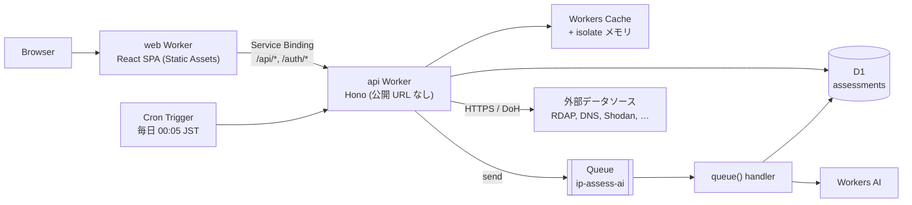
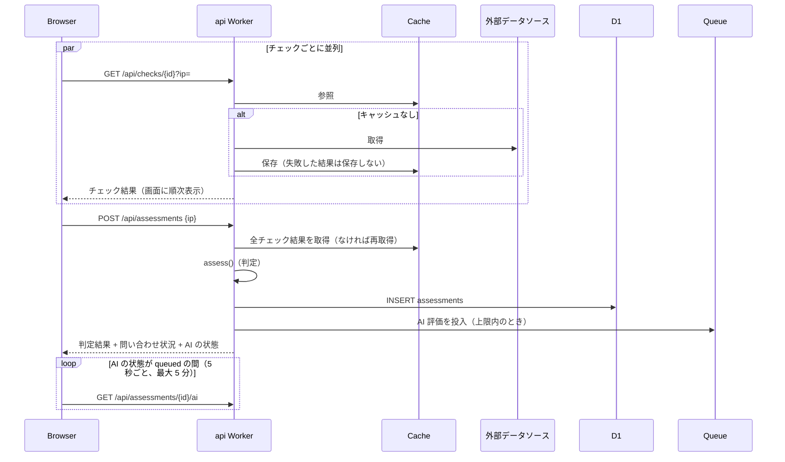
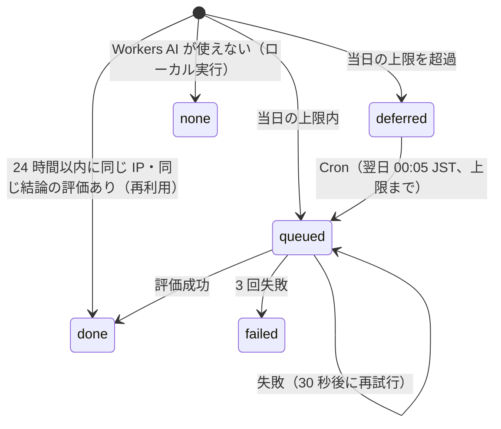

# ip-assess-web

[ip-assess](https://github.com/yoshihicode/ip-assess)（bash 版）を Cloudflare Workers（無料枠）で Web サービス化したもの。
アクセス元 IP アドレスの一次調査を行い、「調査優先度（HIGH / MEDIUM / LOW）」とその根拠を示す。安全／危険の結論は出さない。

- 対象: 日本国内向け。画面は日本語・英語
- 対応: IPv4 / IPv6
- 追加機能（bash 版との差分）: AI による評価、同じ IP の問い合わせ状況、複数の DNSBL

## 目次

- [アーキテクチャ](#アーキテクチャ)
- [データベース](#データベース)
- [判定ロジック](#判定ロジック)
- [開発](#開発)
- [デプロイ](#デプロイ)
- [免責事項](#免責事項)
- [既知の制約・要確認](#既知の制約要確認)

## アーキテクチャ

### 全体構成



| 構成要素 | 役割 |
| :--- | :--- |
| web Worker（`apps/web`） | React SPA を静的アセットとして配信する。`/api/*` `/auth/*` だけを Service Binding で api Worker に渡す（`run_worker_first`） |
| api Worker（`apps/api`） | チェックの実行、判定、D1 への保存、AI 評価の受付。`workers_dev: false` で公開 URL を持たない |
| `packages/core` | IP の解析、各データソースの応答の解析、判定ロジック。**画面と API の両方で使う**（画面では入力検証に使用） |
| D1 | 問い合わせ 1 件ごとの判定結果と AI 評価。問い合わせ状況の集計元 |
| Workers Cache / メモリ | 各チェックの結果と、大きな一覧（Tor・IPsum・DROP）のキャッシュ |
| Queue + Workers AI | AI 評価を非同期で実行する |
| Cron | 前日に上限を超えて保留した AI 評価を投入する |

### リクエストの流れ

画面は 9 種類のチェックを並列に呼び、終わったものから表示する。すべて終わったら判定と保存を依頼する。
1 回の呼び出しに処理を集中させないのは、無料枠の CPU 時間が呼び出し 1 回あたり 10ms のため。



### API

すべて api Worker の `/api` 配下。IP は `packages/core` の `parseIp` と `isGlobalUnicast` で検証し、プライベート・予約済みアドレスは拒否する。

| メソッド | パス | 内容 |
| :--- | :--- | :--- |
| GET | `/api/checks/:id?ip=` | チェックを 1 つ実行する。`id` は下表のいずれか |
| POST | `/api/assessments` | `{ "ip": "..." }` を判定して保存する。判定結果・問い合わせ状況・AI の状態を返す |
| GET | `/api/assessments/:id` | 保存済みの結果（チェック結果を含む）。画面の `?id=` 表示で使う |
| GET | `/api/assessments/:id/ai` | AI 評価の状態と結果 |
| GET | `/api/history?ip=` | 同じ IP の問い合わせ状況 |
| GET | `/api/health` | 稼働確認 |

エラーは `{ "error": "<code>" }`（`invalid_ip` / `not_global` / `rate_limited` / `not_found` / `internal_error` など）。
利用者の IP ごとに 1 分 120 回のレート制限がある（Rate Limiting バインディング）。

### チェック（外部データソース）

| id | データソース | 取得方法 | キャッシュ |
| :--- | :--- | :--- | :--- |
| `rdap` | RDAP（APNIC から各 RIR へリダイレクト） | HTTPS | 6 時間 |
| `dns` | 逆引き（PTR）と FCrDNS | DoH | 1 時間 |
| `asn` | Team Cymru IP to ASN Mapping | DoH（TXT） | 6 時間 |
| `dnsbl` | DroneBL・SpamCop・PSBL（Spamhaus ZEN は DQS キーがある場合のみ） | DoH | 30 分（リストの健全性確認は 1 時間） |
| `drop` | Spamhaus DROP | HTTPS（JSON） | 1 時間 |
| `tor` | Tor Project の出口ノード一覧 | HTTPS | 30 分 |
| `ipsum` | IPsum（IPv4 のみ） | HTTPS（約 2MB） | 結果 1 時間 / 一覧 12 時間 |
| `internetdb` | Shodan InternetDB | HTTPS | 6 時間 |
| `geofeed` | RDAP に記載された Geofeed（https のみ） | HTTPS | 6 時間 |

- DNS は Workers で dig を実行できないため DoH（`cloudflare-dns.com`）を使う。設定は `DOH_ENDPOINT`
- キャッシュは isolate 内のメモリと Workers Cache の 2 段。**失敗した結果はキャッシュしない**（一時的な障害を固定化しないため）
- IPsum は行に分割せず文字列検索で該当行だけを取り出す。Geofeed は先頭のオクテットで絞り込んでから解析する（どちらも CPU 時間対策）

### AI 評価

- モデルは `AI_MODEL`（既定: `@cf/meta/llama-3.3-70b-instruct-fp8-fast`）、出力言語は `AI_LANGUAGE`（既定: English）
- プロンプトには判定結果と各チェックの要点だけを JSON で渡す（`apps/api/src/ai.ts` の `buildFacts`）
- RDAP の備考欄などは第三者が書ける文字列のため、「信頼しないデータ」としてプロンプトに明記している。
  出力は画面にテキストとしてのみ表示する
- 1 日の上限は `AI_DAILY_LIMIT`（既定: 20 件、日本時間で数える）

`ai_status` の遷移:



## データベース

D1（SQLite 互換）のテーブルは 1 つ。**問い合わせ 1 件 = 1 行**で、同じ IP を何度調べても行を追加する。
問い合わせ状況（いつ・どれくらい問い合わせがあったか）はこのテーブルを IP で集計して求める。

マイグレーション: [`apps/api/migrations`](apps/api/migrations)

### `assessments`

| 列 | 型 | 内容 |
| :--- | :--- | :--- |
| `id` | TEXT PK | UUID（`crypto.randomUUID()`）。画面の `?id=` に使う |
| `ip` | TEXT NOT NULL | 正規化済みの IP（IPv6 は RFC 5952 の短縮形・小文字。IPv4 射影アドレスは IPv4 に変換） |
| `version` | INTEGER NOT NULL | 4 または 6 |
| `created_at` | TEXT NOT NULL | 判定日時（ISO 8601、UTC） |
| `priority` | TEXT NOT NULL | `HIGH` / `MEDIUM` / `LOW` |
| `infra_class` | TEXT NOT NULL | 回線種別（`datacenter` / `consumer_isp` / `tor` など） |
| `infra_score` | INTEGER NOT NULL | 回線種別のスコア |
| `threat_level` | TEXT NOT NULL | `DETECTED` / `UNKNOWN` / `NONE_FOUND` |
| `result_json` | TEXT NOT NULL | `{"assessment": Assessment, "checks": CheckResults}`（型は `packages/core/src/types.ts`）。約 6KB/件（実測） |
| `ai_status` | TEXT NOT NULL | `none` / `queued` / `deferred` / `done` / `failed`（既定 `none`） |
| `ai_requested_at` | TEXT | AI に投入した日時。1 日の上限の集計に使う |
| `ai_completed_at` | TEXT | AI 評価が終わった（または失敗した）日時 |
| `ai_model` | TEXT | 使用したモデル |
| `ai_result` | TEXT | AI 評価の JSON（`verdict` / `confidence` / `summary` / `key_points` / `recommended_actions` / `caveats`） |

`priority` などの要約列は `result_json` と重複しているが、一覧表示や集計で JSON を解析しないために持っている。

### インデックス

| 名前 | 列 | 用途 |
| :--- | :--- | :--- |
| `idx_assessments_ip_created` | `(ip, created_at)` | 同じ IP の問い合わせ状況の集計・一覧、AI 評価の再利用 |
| `idx_assessments_ai` | `(ai_status, ai_requested_at)` | 当日の AI 投入件数の集計、保留分の取り出し |

### 主なクエリ（`apps/api/src/db.ts`）

| 関数 | 内容 |
| :--- | :--- |
| `getHistory` | 同じ IP の累計・24 時間・7 日・30 日の件数、初回日時、直近 20 件 |
| `countAiToday` | 日本時間の当日 0 時以降に AI に投入した件数 |
| `findRecentAi` | 同じ IP の 24 時間以内の AI 評価（再利用用） |
| `listDeferred` | 保留中の AI 評価（古い順） |

### 保存期間

古い行を削除する処理はまだない。1 件約 6KB のため、件数が増えた場合は保存期間を決めて Cron で削除する必要がある。

### 取り扱いの注意

`result_json` には RDAP の登録情報（担当者の氏名・住所・メールアドレスを含む場合がある）がそのまま入る。
公開情報だが個人情報を含みうるため、データベースの持ち出しや共有は慎重に行うこと。

## 判定ロジック

`packages/core/src/assess.ts`。bash 版 v1.6.0 の判定を移植している。

- **回線種別**（加点・減点）と**脅威の評判**（検出の有無のみ）の 2 軸で評価し、合算しない。
  感染した家庭の PC（国内 ISP -5 点 + ブラックリスト掲載）が「低リスク」に見えるのを防ぐため
- 調査優先度: 脅威シグナルがあれば HIGH。なければスコア 4 以上で HIGH、1〜3 で MEDIUM、それ以外は LOW
- 確認できなかったチェックは「Unknown」とし、加点しない。結果は確実性 `PARTIAL` として列挙する
- 判定は言語に依存しない ID と値（`Indicator`）を返し、文言は画面側（`apps/web/src/i18n.ts`）で組み立てる

### bash 版との違い

- DNS は DoH で問い合わせる
- Ping が使えないため、遅延と「仮想ロケーション」は判定しない（`na`）
- DNSBL は複数ある。DroneBL は脅威シグナル、SpamCop と PSBL は迷惑メール専用のため参考情報。
  各リストに RFC 5782 のテスト用アドレスを問い合わせ、正しく応答しないリストの「未掲載」は信用しない
- Spamhaus は **DROP**（HTTP で一覧を取得、IPv4/IPv6）を脅威シグナルとして使う。
  ZEN は公開リゾルバ経由では拒否されるため、DQS キー（`SPAMHAUS_DQS_KEY`）がある場合のみ使い、なければ「対象外」と表示する
- IPsum は IPv4 のみ（IPv6 は「対象外」と表示）

### Spamhaus DROP の利用条件

無料で、事業の規模・種類を問わず利用できる。製品で使う場合は Spamhaus Project の表記が必要で、
日付と © 表記をデータとともに残すこと（https://www.spamhaus.org/drop/terms/）。
画面では DROP の行とデータソース欄に © 表記とリストの更新日時を表示している（消さないこと）。

## 開発

```bash
npm install
npm run dev:local    # ログイン不要。AI 評価なし。http://localhost:8787
npm run dev          # AI 評価あり。事前に `npx wrangler login` が必要（Workers AI はリモートで実行され、利用枠を消費する）
npm test             # core のテスト
npm run typecheck
```

- どちらも画面のビルドとローカル D1 のマイグレーションを自動で行い、web と api を同時に起動する
- ローカルの D1 は `.wrangler/state` に SQLite として保存される（消すと問い合わせ履歴も消える）。本番の D1 とは別
- `dev:local` は api の `env.local`（AI バインディングなし）を使う。起動時の `"ai" exists at the top level, but not on "env.local"` などの警告は想定どおり。
  バインディングと `vars` は環境ごとに継承されないため、`apps/api/wrangler.jsonc` を変更したら `env.local` も合わせること

ローカルの履歴を見る:

```bash
npx wrangler d1 execute ip-assess -c apps/api/wrangler.jsonc --local --persist-to .wrangler/state \
  --command "SELECT ip, created_at, priority, threat_level, ai_status FROM assessments ORDER BY created_at DESC LIMIT 20"
```

### ディレクトリ

```
packages/core/
  src/ip.ts          IP の解析・正規化・プレフィックス判定・逆引き名
  src/rdap.ts        RDAP の解析（住所・Abuse 連絡先・Geofeed URL など）
  src/cymru.ts       Team Cymru の TXT の解析
  src/geofeed.ts     Geofeed の照合
  src/dnsbl.ts       DNSBL の定義と応答コードの意味
  src/drop.ts        Spamhaus DROP の解析と照合
  src/assess.ts      判定ロジック
  src/types.ts       チェック結果・判定結果の型
  test/              vitest
apps/api/
  src/index.ts       ルーティング、queue() / scheduled() ハンドラ
  src/checks/        各チェックの取得処理
  src/doh.ts         DoH クライアント
  src/cache.ts       キャッシュ（メモリ + Workers Cache）
  src/db.ts          D1 へのアクセス
  src/ai.ts          Workers AI のプロンプトと応答の検証
  migrations/        D1 のマイグレーション
apps/web/
  worker/index.ts    静的アセットの配信と /api の転送
  src/App.tsx        画面全体と URL（?ip= / ?id=）の扱い
  src/useAssessment.ts  チェックの並列実行・判定の依頼・AI のポーリング
  src/components/Report.tsx  結果の各セクション
  src/i18n.ts        日本語・英語の文言
```

## デプロイ

```bash
npx wrangler login
npx wrangler d1 create ip-assess          # 出力された database_id を apps/api/wrangler.jsonc に設定（env.local の分も）
npx wrangler queues create ip-assess-ai
npm run db:migrate:remote
npm run deploy                            # api → web の順にデプロイ（web は api への Service Binding を持つため）
# 任意: Spamhaus DQS を使う場合
npx wrangler secret put SPAMHAUS_DQS_KEY -c apps/api/wrangler.jsonc
```

アクセス制御は未実装。社内利用なら Cloudflare Access（Zero Trust）で web Worker を保護することを想定。

## 免責事項

画面の下部にも同じ内容を日本語・英語で表示している（`apps/web/src/i18n.ts` の `disclaimer`）。変更する場合は両方を合わせること。

- 本サービスの結果は、アクセス元 IP アドレスの一次調査のための参考情報です。安全・危険を判定するものではなく、「LOW」や「未検出」は安全であることを意味しません。
- 結果は第三者のデータソース（RDAP、DNS、Shodan InternetDB、Spamhaus DROP、IPsum、Tor Project など）に基づきます。これらの情報の正確性・完全性・最新性は保証されず、登録情報や申告所在地は誤っている場合があります。
- AI による評価は自動生成された参考情報であり、誤りを含む可能性があります。
- 遮断・通報などの対応は、本サービスの結果だけで判断せず、アクセスログなどの根拠を確認したうえで、利用者の責任で行ってください。本サービスの利用によって生じた損害について、提供者は責任を負いません。
- 調査のため、入力した IP アドレスは外部のデータソース（RDAP・DNS リゾルバ・DNSBL の運営者・Shodan など）に送信されます。また、問い合わせ内容と結果は問い合わせ状況の集計のために記録されます。
- 各データソースの権利はそれぞれの提供者に帰属します。Spamhaus DROP: © The Spamhaus Project SLU。

## 既知の制約・要確認

- Spamhaus ZEN（XBL: 感染端末、SBL: スパム送信元）は DQS キーなしでは使えない。
  無料 DQS は非商用かつメールサーバー運用者向けのため対象外。
  XBL を十分に代替できる無料のリストはなく、乗っ取られた家庭の端末の検出力は bash 版（ZEN 利用時）より下がる
- Cache API は `*.workers.dev` では無効。独自ドメインがない場合はメモリのキャッシュのみになる
- Shodan InternetDB は商用製品への組み込みに別途ライセンスが必要（企業内利用は可）
- DroneBL の応答コードの意味、一般家庭向け ISP / ホスティングの ASN 一覧は bash 版から引き継いだもので、照合が残っている
- D1 の古い行を削除する処理がない（保存期間は未定）
- Workers AI の評価と Cron は、実環境でまだ動作を確認していない
